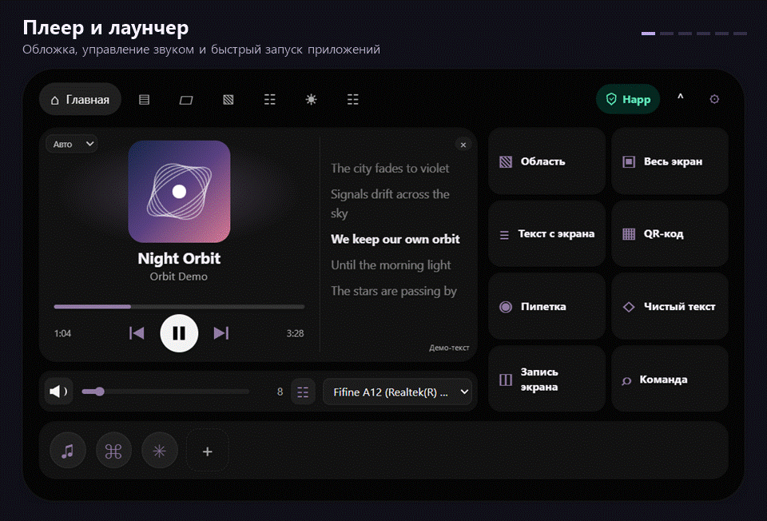

# Orbit для Windows 10 и 11



Orbit — настраиваемый островок у верхней кромки экрана. Свёрнутая панель показывает время, погоду и воспроизведение. Наведите курсор, чтобы раскрыть панель. Поведение можно изменить в отдельном окне настроек.

## Установка

1. Скачайте [Orbit-Setup-v0.3.3.exe](https://github.com/TrashDokiDoki/Orbit/releases/download/v0.3.3/Orbit-Setup-v0.3.3.exe). Установщик автоматически выбирает нативную сборку AMD64 (x64, процессоры Intel и AMD) или ARM64.
2. Запустите установщик и откройте Orbit из меню «Пуск». Готовая сборка включает Electron. Сборка предназначена для Windows 10 22H2 и Windows 11. Установка и запуск проверены на Windows 11 AMD64. Содержимое ARM64-пакета проверено при тестовой установке. Запуск на ARM64 и Windows 10 пока не проверен.
3. Откройте настройки через кнопку с шестерёнкой или меню значка в трее. В разделе «Общее» можно изменить форму островка и переключить аппаратное ускорение. Переключатель GPU применяется после перезапуска.

Orbit проверяет новые стабильные релизы GitHub при запуске и каждые шесть часов. В разделе «Обновления» можно проверить версию вручную и открыть страницу релиза.

## Возможности

- **Плеер.** Обложка, управление и прогресс для системных медиасессий Windows. Spotify и Яндекс Музыка в приложении или браузере поддерживаются, когда источник передаёт медиасессию Windows. Orbit ищет текст в LRCLIB при смене трека и подсвечивает строки по времени, если найдена синхронизированная версия.
- **Звук.** Ползунок громкости, выключение звука, выбор устройства вывода и настройки эквалайзера.
- **Погода.** Температура и значок в свёрнутой панели, почасовой и недельный прогноз, ветер, влажность, давление, восход и закат, осадки и УФ-индекс. Город выбирается нажатием на его название. Источник данных — Open-Meteo.
- **Лаунчер и полка.** Ярлыки приложений и сайтов, перетаскивание файлов на полку, в лаунчер или в чат. Spotify, ChatGPT и Codex можно добавить как кнопки запуска.
- **Управление.** Уведомления о раскладке и Caps Lock, интеграция с установленным Happ, системные действия Windows.
- **Сеть.** Переключение установленной службы Zapret и локального TG WS Proxy. Для Zapret сначала настройте службу через `service.bat → Install Service`. Для TG WS Proxy выберите официальный EXE во вкладке «Сеть». Happ остаётся доступен отдельно.
- **Инструменты.** Заметки, таймер и напоминания, история буфера, захват экрана, OCR, QR и пипетка.

[Настройки, клавиши, хранение данных и ограничения](resources/app/README.md)

## Запуск из исходников

Установите Node.js 22+ с npm. В PowerShell из папки репозитория выполните:

```powershell
cd resources/app
npm install
npm run check
npm start
```

Команды `npm run build:win` и `npm run build:win:arm64` создают распакованные сборки для AMD64 и ARM64 в `resources/app/dist`. Запускайте `Orbit.exe` из этой папки вместе с остальными файлами сборки.

Исходный код Orbit распространяется по [лицензии MIT](resources/app/LICENSE).
